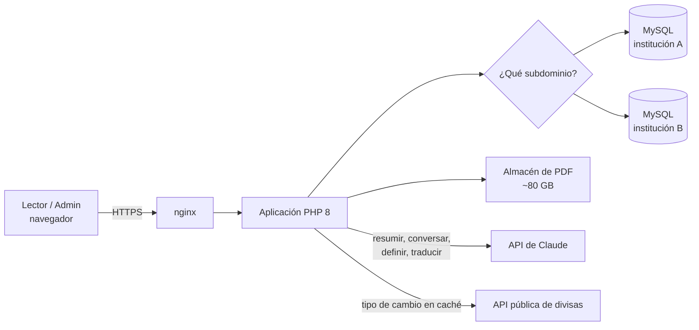

[🇬🇧 English](README.md) · [🇪🇸 Español](README.es.md)

# Hispania — Plataforma de Biblioteca Virtual

**Hispania** es una biblioteca virtual por suscripción: miles de libros que se leen en el
navegador con un lector de pasar página, un asistente de IA para cada libro y un panel de
administración para gestionar el catálogo de una o varias instituciones.

Está en producción en **[biblioteca-intermoviltec.com](https://biblioteca-intermoviltec.com)**.

> **Este repositorio es una vitrina técnica.** El código fuente es privado porque se trata de un
> producto comercial. Aquí se documenta qué hace la plataforma y cómo está construida. Puedo
> mostrar el código en una sesión en vivo si lo solicitas.

## Qué hace

### Para los lectores
- **Catálogo por categorías** con búsqueda de texto completo ordenada por relevancia (índice
  FULLTEXT de MySQL sobre título, autor y contenido). El catálogo solo está disponible tras iniciar sesión.
- **Lector de PDF en el navegador** basado en PDF.js, con efecto de pasar página.
- **Progreso de lectura** guardado por libro y usuario, para continuar donde se dejó.
- **Favoritos, historial de lectura y notas personales** en cada libro.
- **Asistente de IA en cada libro**, con la API de Claude: resumir el libro, conversar sobre su
  contenido, definir términos y traducir fragmentos. Si no hay API key configurada, la plataforma
  sigue funcionando y solo se desactivan estas funciones.
- **Interfaz en cinco idiomas:** español, inglés, italiano, alemán y francés. Incluye modo oscuro.

### Para el negocio
- **Planes de suscripción con descuento por volumen** (individual → Enterprise+) para la
  biblioteca, una videoteca y un plan combinado.
- **Simulador de precios en cuatro monedas** (PEN, USD, EUR, GBP). El tipo de cambio se obtiene de
  una API pública, se guarda en caché y, si la API falla, se usan los últimos valores conocidos.
- **Varias instituciones con un solo código:** cada institución tiene su subdominio, su marca y su
  propia base de datos (mismo esquema), así los datos de los clientes nunca se mezclan.

### Para los administradores (panel AdminLTE)
- Gestión de libros, categorías, usuarios, visitantes, suscriptores, mensajes y blog.
- **Importación masiva** de libros y usuarios desde CSV. Si un usuario no trae contraseña, se le
  genera una temporal, guardada como hash.
- **Generación automática de portadas** a partir de la primera página de cada PDF.
- **Analítica de uso:** actividad de lectura, estadísticas por usuario y reportes.

## Arquitectura

| Capa | Tecnología |
|---|---|
| Servidor web | nginx en un VPS Linux (Ubuntu 24.04) |
| Backend | PHP 8.1+, mysqli, Composer (SDK PHP de Anthropic, Guzzle) |
| Base de datos | MySQL / MariaDB, una base por institución |
| Frontend | PHP renderizado en servidor, Bootstrap, jQuery |
| Lector | PDF.js con capa de pasar página |
| Administración | AdminLTE, DataTables, Chart.js, reportes con FPDF |
| IA | API de Claude (Anthropic) |

## Seguridad

- **Tokens CSRF** en todos los formularios.
- **Contraseñas con bcrypt** (`password_hash` y `password_verify`). Las cuentas antiguas con
  contraseña en texto plano se migran a hash automáticamente en su siguiente inicio de sesión.
- **Protección contra fuerza bruta:** límite de intentos fallidos por usuario (5) y por IP (20) en
  una ventana de 15 minutos. Se cuenta por el usuario enviado, así el límite no revela si una cuenta
  existe, y el tiempo se calcula con el reloj de la base de datos para evitar desfases de zona horaria.
- **Catálogo protegido:** sin sesión, las páginas de libros redirigen al inicio.
- **Secretos fuera del control de versiones:** las credenciales de la base de datos y las API keys
  están en archivos de configuración locales no versionados.
- **Derechos de autor y privacidad desde el diseño:** nunca se suben los archivos de los libros ni
  datos reales de usuarios.

## Capturas

| Inicio | Planes de suscripción |
|---|---|
|  |  |

## Autor

Diseñado y desarrollado por **José Antonio Ortiz Rojas**, fundador de
[Intermovil TEC](https://intermoviltec.com).
[LinkedIn](https://www.linkedin.com/in/jos%C3%A9-antonio-o-5b621b29) ·
[GitHub](https://github.com/AntonioOrojas) ·
[j.antonio.o.rojas@gmail.com](mailto:j.antonio.o.rojas@gmail.com)

El contenido de esta página es © Intermovil TEC. Todos los derechos reservados.
