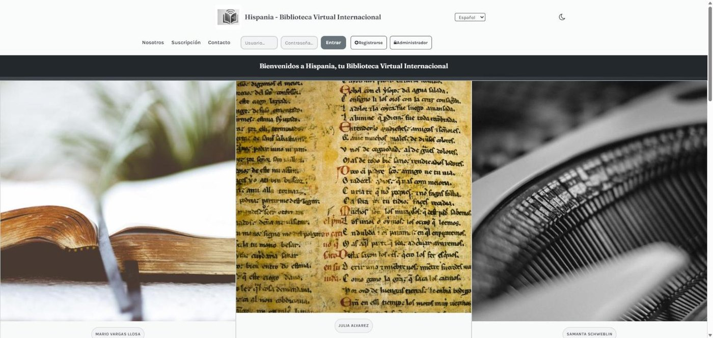
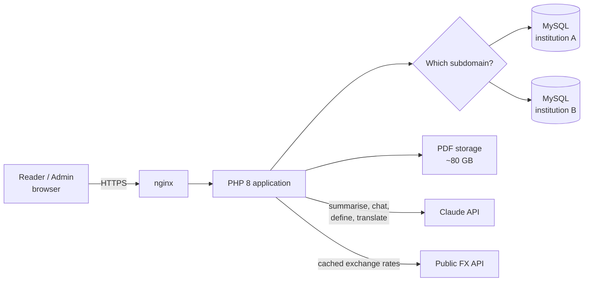
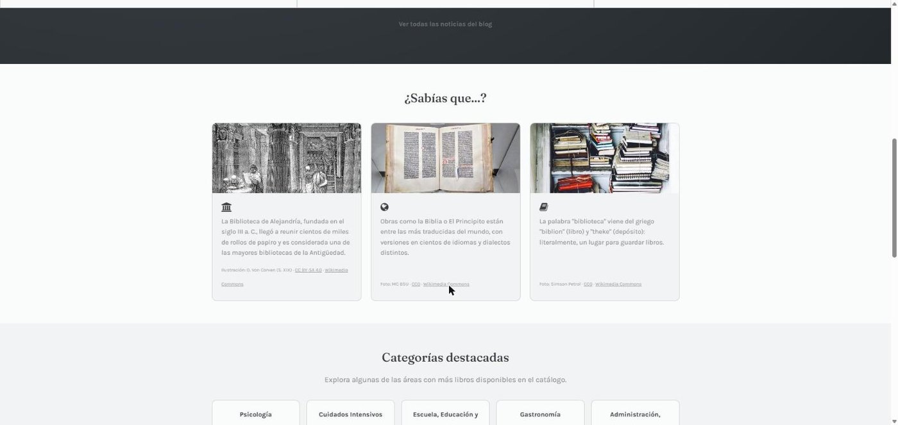
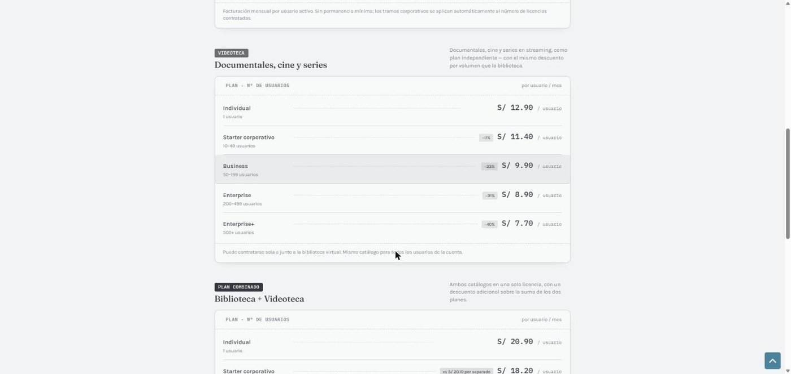

[🇬🇧 English](README.md) · [🇪🇸 Español](README.es.md)

# Hispania — Virtual Library Platform

**Hispania** is a subscription-based virtual library: thousands of books, read in the
browser with a page-turn reader, an AI assistant for every book, and an admin panel
for running the catalogue for one or many institutions.

It is in production at **[biblioteca-intermoviltec.com](https://biblioteca-intermoviltec.com)**.

> **This repository is a technical showcase.** The source code is private because it is a
> commercial product. This page documents what the platform does and how it is built. A live
> walkthrough of the code is available on request.

## What it does

### For readers
- **Catalogue by category** with relevance-ranked full-text search (MySQL FULLTEXT on title, author and content). The catalogue is only available after signing in.
- **In-browser PDF reader** built on PDF.js, with a page-flip effect for a book-like experience.
- **Reading progress** saved per book and user, so readers pick up where they left off.
- **Favourites, reading history and personal notes** on each book.
- **AI assistant for every book**, powered by the Claude API: summarise a book, chat about its
  content, define terms and translate passages. If no API key is configured, the platform keeps
  working and only these features are switched off.
- **Five interface languages:** Spanish, English, Italian, German and French. Dark mode included.

### For the business
- **Subscription plans with volume discounts** (individual → Enterprise+), for the library,
  a video library and a combined plan.
- **Live price simulator in four currencies** (PEN, USD, EUR, GBP). Exchange rates come from a
  public API, are cached on disk and fall back to the last known values if the API is down.
- **Multi-institution from one codebase:** each institution gets its own subdomain, branding and
  separate database (same schema), so data never mixes between clients.

### For administrators (AdminLTE panel)
- Manage books, categories, users, visitors, subscribers, messages and the blog.
- **Bulk import** of books and users from CSV. Users without a password get a temporary one,
  stored as a hash.
- **Automatic cover generation** from the first page of each PDF.
- **Usage analytics:** reading activity, per-user statistics and usage reports.

## Architecture

| Layer | Technology |
|---|---|
| Web server | nginx on a Linux VPS (Ubuntu 24.04) |
| Backend | PHP 8.1+, mysqli, Composer (Anthropic PHP SDK, Guzzle) |
| Database | MySQL / MariaDB, one database per institution |
| Frontend | Server-rendered PHP, Bootstrap, jQuery |
| Reader | PDF.js with a page-flip layer |
| Admin | AdminLTE, DataTables, Chart.js, FPDF reports |
| AI | Claude API (Anthropic) |

## Security

- **CSRF tokens** on every form.
- **Passwords hashed with bcrypt** (`password_hash` and `password_verify`). Legacy plaintext
  accounts are migrated to a hash automatically at their next successful login.
- **Brute-force protection:** failed logins are limited per username (5 attempts) and per IP
  (20 attempts) in a 15-minute window. Attempts are tracked by the submitted username, so the
  limiter does not reveal whether an account exists, and time is computed with the database clock
  to avoid time-zone drift between PHP and MySQL.
- **Catalogue behind authentication:** book pages redirect to the home page without a session.
- **Secrets kept out of version control:** database credentials and API keys live in
  untracked local config files.
- **Copyright and privacy by design:** book files and real user data are never committed.

## Screenshots

| Home | Subscription plans |
|---|---|
|  |  |

## Author

Designed and built by **José Antonio Ortiz Rojas**, founder of
[Intermovil TEC](https://intermoviltec.com).
[LinkedIn](https://www.linkedin.com/in/jos%C3%A9-antonio-o-5b621b29) ·
[GitHub](https://github.com/AntonioOrojas) ·
[j.antonio.o.rojas@gmail.com](mailto:j.antonio.o.rojas@gmail.com)

The content of this page is © Intermovil TEC. All rights reserved.
